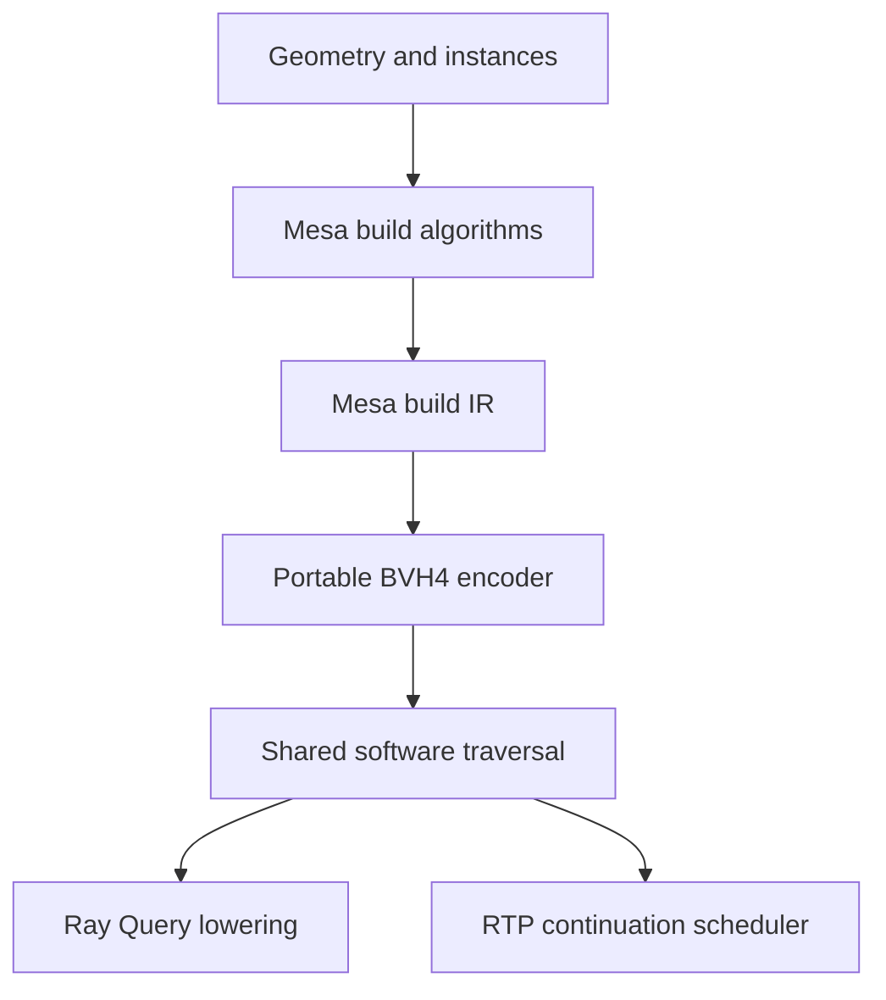

<!-- Copyright 2026 The Khronos Group Inc. -->
<!-- SPDX-License-Identifier: Apache-2.0 -->

# Software Ray Tracing Fallback: Implementation Goal

**Project status:** active development; the complete fallback is not implemented.
This is the current implementation contract, reviewed on 2026-10-25 against
baseline `f18c40d316688066834d1334b2c666d1d60b9351`.

## Outcome

Implement a Vulkan layer that provides the complete mandatory functionality of
`VK_KHR_acceleration_structure`, `VK_KHR_ray_query`, and
`VK_KHR_ray_tracing_pipeline` on qualifying Vulkan devices without native RT.
Unmodified applications use their ordinary AS objects, descriptors, SPIR-V shaders,
SBTs, and trace/query commands. GPU compute builds AS. Software traversal and
intersection run in the consuming shader stage for Ray Query and in compute for
RT pipelines; no native RT extension, shader instruction, or driver-private BVH
interface is required downstream.

Ray Query and RT pipelines must share one versioned AS representation, object
model, builder, and resumable traversal core. An AS built once must be usable by
both consumers. A triangle demo, imported reference source, isolated continuation
test, or one working shader pattern does not complete this goal.

Develop on `codex/ray-tracing-fallback`. Keep implementation, evidence, failures,
and the next actionable work item in this repository. Complete milestones only
after their exit criteria are demonstrated; do not mark the full goal complete
because an intermediate subset runs.

## Architecture decisions

| Module | Selected route |
| --- | --- |
| API and objects | One layer-owned AS/device/descriptor model for RQ and RTP |
| GPU AS build | Reuse Mesa leaf, Morton sort, LBVH, PLOC, and HPLOC algorithms with a public-Vulkan host adapter |
| Build intermediate | Original Mesa build IR; internal construction interface only |
| Traversal representation | Portable BVH4 with FP32 child bounds, inspired by RADV BOX32 |
| Traversal | Layer-owned software implementation of the applicable RADV algorithms/state machine |
| Ray Query | Typed SPIR-V lowering to resumable traversal operations in the original shader stage |
| RT Pipeline | Typed SPIR-V continuation/state-machine lowering into a compute program |
| Continuation/runtime reference | D3D12RaytracingFallback and its DXC passes; Mesa NIR as a secondary reference |
| OMM | Independent native-RT workstream; shared evaluator can be integrated later |

The runtime ABI is layer-owned, not a copy of AMD's GPU address encoding or binary
AS format. Use 64-bit checked byte-size/address arithmetic. Tagged node indices may
remain 32-bit if their capacity covers the advertised requirements and indexing
uses 64-bit multiplication. Bounds, original IDs, geometry flags, instance data,
parent links, and update metadata have explicit versioned layouts.

Mesa IR is not the final traversal format. The final implementation must not keep
both the old D3D working tree and Mesa IR as permanent redundant traversal data.
Retain only data required for the runtime and supported updates after construction.

### Change from the earlier port contract

The earlier exact D3D12 builder reproduction requirement is superseded by the
explicit Mesa-build/BVH4 decision. Microsoft remains the architectural and
behavioral reference for continuation lowering, the runtime, and relevant tests.
Preserve source provenance and document adaptations. This does not reduce shader
or Vulkan API coverage, and does not import upstream limitations such as missing
callables or ignored dispatch depth as acceptable Vulkan behavior.

The unpushed raw-Mesa-IR traversal experiment predating this goal is not the chosen
runtime or a prerequisite to merge. Migrate intentionally from the committed
baseline; do not accidentally publish that paused working tree.

## Device and compatibility contract

The initial implementation route targets 64-bit Vulkan devices with compute,
buffer device address, shader integer capabilities, required storage access,
layout, and memory-model features used by the selected shader variants. Pin the
exact Vulkan/SPIR-V/Mesa revisions and determine this capability predicate from
compiled SPIR-V and actual device queries before enabling support.

These are underlying-device prerequisites, not permission to reduce mandatory
RT functionality below Vulkan's required limits. PLOC's original 1024-invocation
workgroup or HPLOC's subgroup constraints must select eligible implementations;
they must not silently become universal requirements if another correct builder
can serve the device. Unsupported optional feature bits stay false until tested.

The final layer must support legal applications at the limits it reports,
including the applicable mandatory minimums. Current prototype limits are not a
valid final contract. At minimum, audit geometry/instance/primitive counts,
dispatch invocation count, AS descriptor counts, hit-attribute size, alignments,
and recursion/stack behavior against the pinned specification.

No spare descriptor set, storage-buffer slot, or push-constant space may be assumed
for a general transparent path. Account for physical descriptor budgets when
virtualizing AS bindings. Do not lower device limits below Vulkan guarantees to
make room. Prove a resource-delivery strategy for fully occupied application
layouts, with BDA context snapshots/layout virtualization or a documented semantic
fallback. The concrete mechanism is an M0 proof obligation.

## Required behavior

### Layer and API translation

- Virtualize extension enumeration, feature/property/format queries, device
  creation, dispatch lookup, and required dependency behavior consistently.
- Strip emulated RT extension names, feature structures, buffer usages, stages,
  access masks, and capabilities before calling a driver that lacks them.
- Preserve unrelated enabled features and `pNext` chains, application allocator
  behavior, command state, threading, object lifetimes, and valid feature interactions.
- Never forward virtual AS/pipeline tokens to native RT entry points. An unsupported
  experimental path must fail explicitly rather than execute a logging-only stub.
- Provide mandatory deferred-host-operation behavior for synchronous completion
  where permitted; optional acceleration-structure host commands remain gated by
  their actual feature support.

### Acceleration structures

- Implement all mandatory device-side AS operations: size/address queries,
  BUILD/UPDATE, clone/compact, property queries, serialization/deserialization,
  compatibility, and their required lifecycle/synchronization behavior.
- Support required input formats, indexed/nonindexed triangles, AABBs,
  multi-geometry BLASes, instance arrays/pointer arrays, transforms, inactive
  primitives/instances, masks, flags, original IDs, and BLAS reuse.
- Use Mesa's common shader/argument contracts where practical. Replace private
  `vk_device`, `vk_meta`, address-fill, and unaligned-dispatch helpers with ordinary
  Vulkan operations and real bounds checks.
- Implement size/scratch planning, initialization, pass synchronization, and
  subgroup/workgroup capability selection for LBVH/PLOC/HPLOC and supported
  32/64-bit Morton variants. Current Mesa sorting is bitonic plus hierarchical
  merging; do not introduce a historical radix-sort dependency without need.
- Preserve the PLOC task/phase sentinel initialization and HPLOC range-buffer
  initialization. Porting the kernels without their host contracts is incomplete.
- Implement UPDATE/refit separately for the selected runtime layout; invoking a
  construction algorithm again does not by itself prove update semantics.
- Use large-AS arithmetic and chunked dispatch without imposing an accidental
  4 GiB byte-offset ceiling. Real allocation failure may return OOM; small
  fabricated size bounds or truncated addresses are unacceptable.

### Shared traversal and Ray Query

- Implement conservative box tests and Vulkan-compatible triangle intersection,
  including floating-point/edge invariants. Preserve procedural candidate behavior,
  opacity precedence, face/primitive culling, and candidate/committed separation.
- Adapt software algorithms rather than depending on AMD intersection instructions,
  private address packing, hardware stacks, or undocumented descriptors.
- Provide a bounded fast traversal stack plus a proven overflow strategy, such as
  parent-based restart or spill. Silently dropping children on overflow is invalid.
  Separate traversal state from the RTP continuation/call stack.
- Lower every base Ray Query instruction and getter. Preserve the actual AS operand
  for each query, including multiple bindings, descriptor arrays/dynamic indexing,
  legal control-flow/function passage, and integer-to-AS conversion.
- Preserve multiple simultaneously live queries, arrays, reinitialization,
  Confirm/Generate/Terminate, all getters, and required shader stages.
- Access large AS storage through BDA or equivalent scalable addressing; requiring
  the entire AS to fit a storage-buffer descriptor range is not the final design.

### RT shader compiler and runtime

- Replace the SPIRV-Cross/GLSL regex path with a typed transformation over validated
  SPIR-V. Preserve entry points, specialization constants, types, resources, and
  legal shader instructions supported by the exposed capability contract.
- Generate resumable states for `TraceRay`, `ReportIntersection`, `ExecuteCallable`,
  and transitive suspending helper calls. Implement Phi-edge liveness, typed frame
  layouts, spills/rematerialization, return values, and control-flow restoration.
- Preserve mutable function-local storage and alias lifetimes across suspension.
  Opaque images/samplers/AS values require provenance and rematerialization, not
  arbitrary byte spills or invalid pointer casts.
- Implement all six base RT shader stages, arbitrary legal payload/attribute/callable
  layouts, hit kinds/builtins, nested traces, callable dispatch, and 3D launch IDs.
- Implement Any-Hit/Intersection suspension and return behavior, including
  IgnoreIntersection, TerminateRay, and ReportIntersection's returned acceptance.
- Preserve SBT indexing, group handles, original shader-record data, multiple raygen
  groups, pipeline library interactions, stack queries/control, and pipeline caches.
- Do not implement recursion by unrolling shader calls to a selected fixed depth.
  Advertised recursion and stack behavior must follow the implemented runtime.
- Do not assume SPIR-V to NIR to SPIR-V is a ready-made backend: adopting it would
  require an executable resource/RT-ABI round-trip proof and an explicit decision.

### Synchronization and execution

Translate RT/AS dependencies to the actual compute/transfer/instrumented-shader
accesses, including barriers, events, semaphores, ownership, query availability,
and valid cross-queue use. Preserve application graphics/compute state around
internal work and valid command-buffer reuse, secondary buffers, concurrent
recording/submission, and GPU-generated inputs. Avoid CPU readback or queue-idle
waits as an architectural requirement.

Optional capture/replay, indirect commands, descriptor-buffer and shader-object
interactions, position fetch, and additional RT extensions require explicit
capability entries and tests where exposed. Do not silently forward an incompatible
path merely because the base driver supports an unrelated extension.

## Milestones and exit criteria

| Milestone | Deliverable and exit criterion |
| --- | --- |
| M0: prove the architecture | Mandatory-limit/capability audit; full-layout resource transport; no-native-RT device creation/dispatch; typed continuation stress proof; versioned BVH4/addressing contract |
| M1: shared AS backend | Mesa build variants to BVH4, GPU encode/refit, structural and numerical reference checks, original-ID/lifetime correctness |
| M2: complete Ray Query | All base opcodes and AS-value paths; query state/opacity/procedural/overflow tests; shared AS consumed in real shaders |
| M3: complete RT Pipeline | Typed continuation compiler and integrated scheduler; all six stages, callable/procedural/recursive shaders, payloads/SBT/stack coverage |
| M4: API and integration | Mandatory AS copy/query/serialization, device/descriptor/pipeline translation, synchronization and lifecycle matrix |
| M5: qualification | Applicable CTS and regression matrix, physical no-RT GPU runs, supported platforms, independent expected results, truthful capability reporting |

M0 mechanisms may be developed in parallel with M1/M2 component work, but M0 is
not complete until its full proof set passes. A CPU encoder is a reference and
layout-validation tool; it does not satisfy the GPU encoding or shared integration
milestones.

The initial [BVH4 reference foundation](../layers/common/rt_fallback/README.md)
provides the experimental C-compatible ABI, checked size planner, CPU encoder,
and structural tests. It is intentionally labelled as component work until the
GPU producers and both consumers adopt it.

## Verification surface

- **No-native-RT execution:** test on an ICD/capture boundary that rejects native
  AS/RQ/RTP features and operations, even when a developer GPU has hardware RT.
  Inspect every downstream call and generated SPIR-V. Also qualify a physical
  device without RT. Lavapipe alone is not cross-vendor qualification.
- **Builder/runtime:** independently check graph structure, leaf coverage, bounds,
  original IDs and transforms for empty/singleton/duplicate/inactive inputs,
  unbalanced trees, multiple geometries, >4 GiB layout arithmetic, update and copy.
  Force each supported build/key/subgroup variant and the traversal-overflow path.
- **RQ:** test all base instructions; two different TLASes selected in one shader,
  indexed descriptors, helper/control-flow AS passage, multiple live queries,
  AABB opacity, candidate/committed state, and each supported native shader stage.
- **Compiler/RTP:** stripped debug names; nested structs/matrices/arrays and multiple
  payload locations; Phi loops; local pointer aliases; opaque values across
  suspension; helper TraceRay/ReportIntersection; callable and nested traces;
  hit side effects; null groups; GPU-generated SBT data where enabled.
- **API/resources:** every mandatory entry point, query result modes,
  serialization relocation, allocation failure, allocator callbacks,
  command-state restoration, synchronization and resource-limit cases.
- **Evidence:** keep reproducible build/test commands and per-revision results.
  Compare unambiguous scenes exactly and specification-allowed result sets where
  candidate ordering or numerical boundaries permit variation. Native differential
  results supplement independent oracles; they are not the only correctness test.

Use sanitizers and SPIR-V validation for compiler/layout code, downstream Vulkan
validation for translated commands, and applicable CTS plus dedicated regressions.
Local test success alone is not a formal Vulkan conformance claim.

## Iteration and stop policy

Choose the next work item from demonstrated gaps and failed proof gates. Preserve
passing behavior, update the status/evidence record, and continue toward the full
goal. Keep unrelated layers and the independent native-RT OMM branch out of scope.
Do not merge the development branch or change published support claims solely to
close a milestone.

If a proof fails, investigate alternatives within the public-Vulkan contract.
If no defensible path remains, report the exact blocker, attempted alternatives,
evidence, and the input/capability required to proceed. A blocked or budget-limited
iteration is not goal completion.

## References

- [Baseline audit and feasibility review](ray_tracing_fallback_review.md)
- [D3D12 source provenance and historical port record](ray_tracing_fallback_port.md)
- [Current RTP executable limitations](ray_tracing_fallback_layer.md)
- [Current RQ executable limitations](../vkrt_layer/README.md)
- [Vulkan required limits](https://docs.vulkan.org/refpages/latest/refpages/source/Required_Limits.html)
- [Ray traversal specification](https://docs.vulkan.org/spec/latest/chapters/raytraversal.html)
- [SPV_KHR_ray_query](https://github.khronos.org/SPIRV-Registry/extensions/KHR/SPV_KHR_ray_query.html)
- [SPV_KHR_ray_tracing](https://github.khronos.org/SPIRV-Registry/extensions/KHR/SPV_KHR_ray_tracing.html)
- [Pinned Mesa common builder](https://github.com/chaotic-cx/mesa-mirror/blob/837ab0e30740abb9ebb60bcd40a5114c68c673d9/src/vulkan/runtime/vk_acceleration_structure.c)
- [Pinned RADV software traversal reference](https://github.com/chaotic-cx/mesa-mirror/blob/837ab0e30740abb9ebb60bcd40a5114c68c673d9/src/amd/vulkan/nir/radv_nir_rt_common.c)
